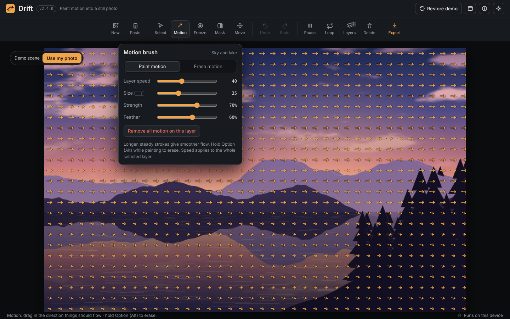
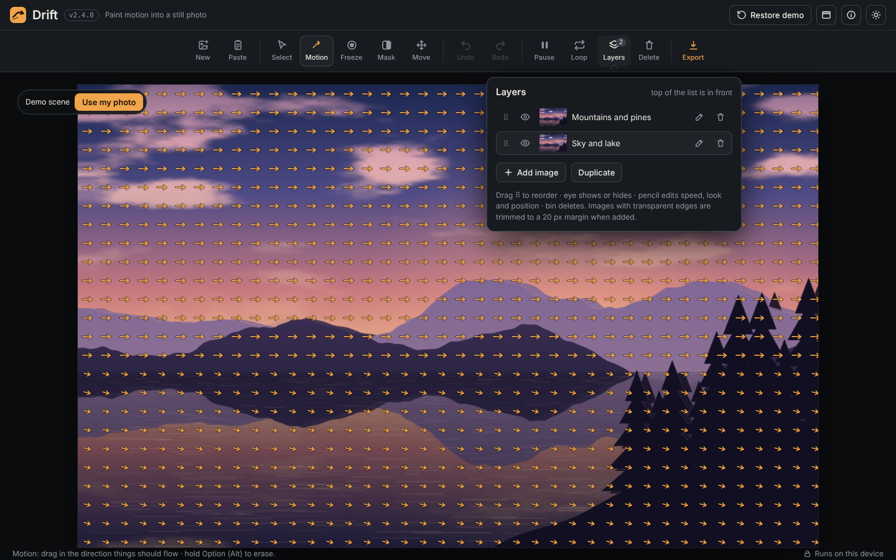
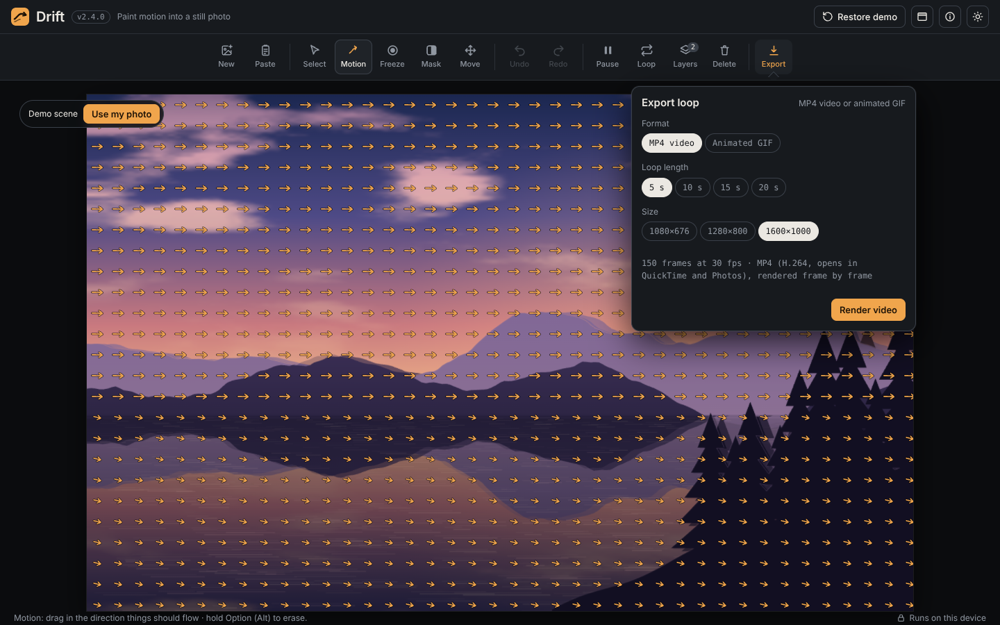
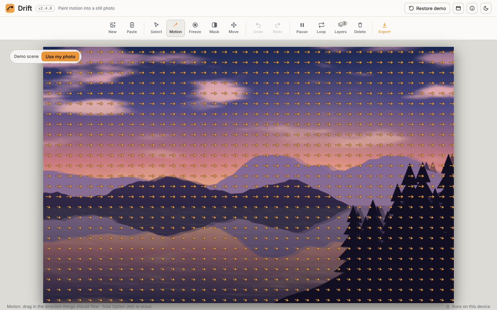
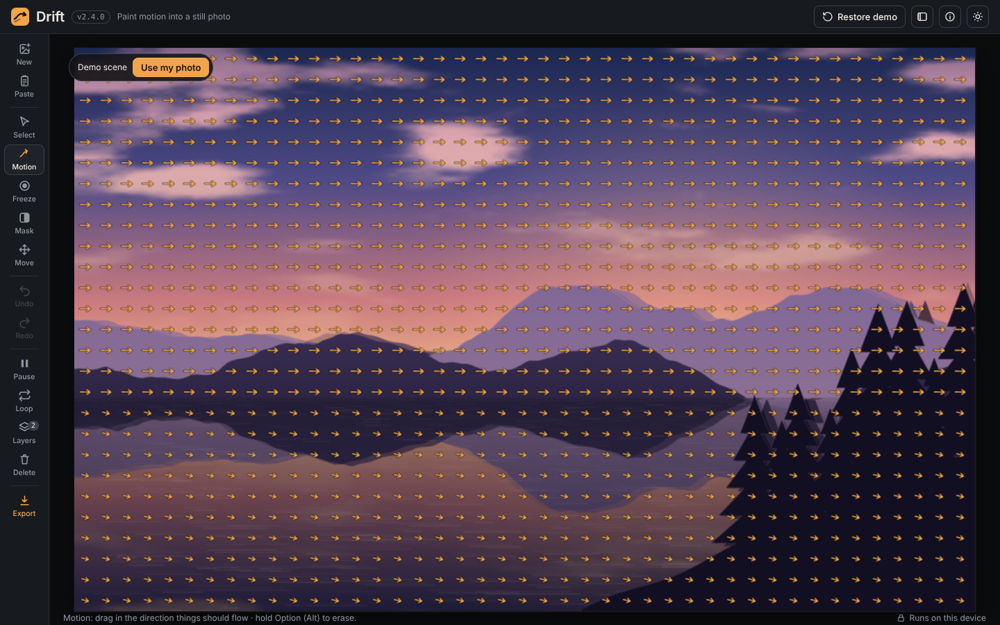

# Drift Studio: User Manual

Version 2.4.0

This manual explains how to use Drift Studio step by step. It assumes no special computer knowledge. Technical words are explained the first time they appear, and a glossary at the end lists every acronym.

## Contents

1. [What the app does](#1-what-the-app-does)
2. [Opening the app](#2-opening-the-app)
3. [Getting to know the screen](#3-getting-to-know-the-screen)
4. [Bringing in a photo](#4-bringing-in-a-photo)
5. [The tools](#5-the-tools)
6. [Playing and setting the loop length](#6-playing-and-setting-the-loop-length)
7. [Layers](#7-layers)
8. [Undo and redo](#8-undo-and-redo)
9. [Exporting your loop](#9-exporting-your-loop)
10. [Day and night mode, and toolbar position](#10-day-and-night-mode-and-toolbar-position)
11. [Keyboard shortcuts](#11-keyboard-shortcuts)
12. [Tips for good loops](#12-tips-for-good-loops)
13. [Troubleshooting](#13-troubleshooting)
14. [Privacy](#14-privacy)
15. [Glossary](#15-glossary)

---

## 1. What the app does

A photo is still. Drift Studio lets you tell parts of the photo to move. You paint arrows over the picture to show the direction of motion. Clouds can drift to the right, water can slide sideways, and grass can sway. When you are finished, the app creates a short video (or a GIF, which is a small looping animation) that repeats smoothly forever.

Here is the built-in demo, a mountain lake scene with the arrows showing where motion is planned:

The orange arrows are the motion you have painted. The small orange-and-red marks on the picture are guides. They are not part of the final loop, and you can hide them in the **Loop** settings.

## 2. Opening the app

1. Find the folder you downloaded from GitHub.
2. Double-click **`index.html`**. It opens in your browser as a small project page.
3. Click **Open the app**. Alternatively, double-click **`drift-studio.html`** to go straight to the app.

Use a current browser such as Safari, Chrome, Edge, or Firefox. The app needs WebGL 2 (see [Troubleshooting](#13-troubleshooting)).

## 3. Getting to know the screen

The screen has four parts.

- **Header (top strip).** Shows the name, the version number (small grey text next to the name), and buttons on the right:
  - **Restore demo** puts the demo scene back. It asks first.
  - **Toolbar position** moves the toolbar to the top, left, or right edge.
  - **How it works** opens a help box with the main steps and shortcuts.
  - **Day / night** switches between a light and a dark look.
- **Toolbar (second strip).** The row of buttons you use to work. Each button is described in the sections below.
- **Picture area (the big middle part).** This is your photo. Your painting appears on top of it.
- **Bottom line.** Gives a one-line hint for the tool you are using and a reminder that the app runs on your device.

Some buttons open a **popover**, a small panel that appears next to the button with settings for that tool. Click the button again, press **Escape**, or click anywhere else to close it.

A small pill in the top-left corner of the picture says **Demo scene**. It goes away as soon as you paint or bring in your own photo.

## 4. Bringing in a photo

There are four ways to bring in a picture.

- **New** (toolbar). Opens your computer's file browser so you can pick a photo. It starts over, so any work you have not exported is cleared. The app asks you to confirm first.
- **Paste** (toolbar). Uses the picture you copied. First copy an image in another program, then press **Paste**. You can also press **⌘V** on a Mac or **Ctrl+V** on Windows anywhere in the app. Some browsers do not let a button read the clipboard, so the app will tell you to use the keyboard instead.
- **Drag and drop.** Drag a picture file from your desktop or Finder window onto the picture area.
- **Use my photo.** The button on the demo pill does the same as **New**.

Supported picture types include JPEG, PNG, WebP, and HEIC (the default photo format on iPhones). If a picture is too large, the app shrinks it to fit what the browser can handle.

**Transparent edges are trimmed.** If you bring in a picture with an empty, see-through border (for example, a logo cut out of its background), the app crops the empty space and leaves a margin of 20 pixels all around.

## 5. The tools

The tools are the buttons in the toolbar, from left to right.

### Select

Click any picture to select its layer. Drag it to move it. Use this when you have several pictures stacked up and want to grab one of them.

When you click, the app picks the top-most picture that has a visible pixel under the cursor. Transparent areas are skipped.

### Motion

This is the main painting tool. Paint over the parts of the picture that should move, and drag in the direction you want them to go.

The Motion popover has these controls.

- **Paint motion / Erase motion.** Paint to add motion, or erase to remove painted arrows. Holding **Option (Alt)** while you paint also erases, without changing the mode.
- **Layer speed.** How fast this whole layer moves. Use the slider, or type an exact number into the box beside it.
- **Size.** How wide the brush is. You can also press the **[** and **]** keys to make it smaller or larger.
- **Strength.** How strongly each stroke pushes the picture. Higher values move things further in each loop.
- **Feather.** How soft the edges of the brush are. A low number gives a hard edge; a high number blends into the picture gradually.
- **Remove all motion on this layer.** Clears every arrow on the selected layer. You can undo this.

Long, steady strokes give smoother motion than short, jerky ones.

### Freeze

Paint **Freeze** over anything that must stay perfectly still, such as a person, a building, or a sign. Frozen areas show the original pixels, so they never wobble.

The Freeze popover has a size control, a feather control, a checkbox called **Tint frozen areas red** (so you can see where you have frozen), and **Clear frozen** to remove all freezes on the selected layer.

### Mask

A **mask** hides parts of a layer so the layers beneath it show through. Choose **Hide** to cover an area or **Reveal** to bring back an area you hid. Use **Reset mask** to start the mask again.

Masks are useful when a layer on top should only show in one part of the picture, like a mountain range that stays in front of moving clouds.

### Move

Moves, resizes, and tilts the selected picture layer.

- **Drag** the picture to move it.
- **Drag a corner square** to resize it.
- **Drag the round handle at the top** to tilt (rotate) it. Hold **Shift** to snap to 15-degree steps.
- **Scroll** or **pinch** to resize with a trackpad or touchscreen.
- The **Scale** and **Rotation** sliders do the same thing with exact numbers. Each has a box where you can type a value.
- **Reset position** puts the layer back in the middle at its original size.

## 6. Playing and setting the loop length

- **Play / Pause** (toolbar, or the **Space** bar) starts and stops the preview so you can see the motion.
- **Loop** opens the loop settings. Choose a **loop length** of 5, 10, 15, or 20 seconds. A longer loop feels more natural and varied, but makes a bigger file.
- **Show motion arrows and stop dots** (in Loop settings) turns the guides on and off. Turn them off to see the picture as it will look in the final file.

The loop is designed to repeat seamlessly. The end of the loop blends back into the start, so the picture never jumps.

## 7. Layers

A **layer** is one picture in the stack. The demo has two: the sky and lake underneath, and the mountains and pine trees on top.

Click **Layers** to open the list. The top of the list is in front of everything else.

Each row has these small icons, from left to right:

| Icon | Name | What it does |
|---|---|---|
| ⠿ | Drag handle | Drag up or down to change the order of the layers. |
| Eye | Show / hide | Click to hide the layer, click again to show it. |
| Thumbnail | Preview | A small copy of the picture. |
| Name | Layer name | The name of the layer. |
| Pencil | Edit | Opens the layer's settings: name, speed, opacity, blend mode, scale, rotation, hue, saturation, brightness, and contrast. |
| Bin | Delete | Removes the layer. You can undo this. |

Under the list there are two buttons:

- **Add image** brings in another picture as a new layer on top.
- **Duplicate** copies the selected layer. The copy sits above the original.

Some layer settings need explaining:

- **Opacity** makes a layer see-through. 100% is solid; 0% is invisible.
- **Blend** decides how a layer mixes with the layers beneath it. **Normal** simply covers them. **Multiply** darkens. **Screen** lightens. **Overlay** and **Soft light** increase contrast in different ways. Try them and see.
- **Hue, Saturation, Brightness, Contrast** change the colour and tone of just that layer.
- **Reset look** brings the colour and blend settings back to normal.

If you delete the last picture, the app asks whether to go back to the demo. It only does so after you confirm.

## 8. Undo and redo

- **Undo** (toolbar, or **⌘Z** on a Mac, **Ctrl+Z** on Windows) reverses your last action.
- **Redo** (toolbar, or **⇧⌘Z**, which is **Shift+Command+Z** on a Mac, or **Ctrl+Shift+Z** on Windows) brings back an action you undid.

The app keeps up to 100 steps, within a set memory limit. When you undo, a small message says how many more steps are available.

Undo works for painting, moving layers, changing settings, deleting, and clearing.

## 9. Exporting your loop

Click **Export** in the toolbar. You can make two kinds of file.

### Choosing your settings

- **Format.**
  - **MP4 video** is the best choice for most uses. It plays in almost every browser, on phones, and in video apps. MP4 is a common video file type.
  - **Animated GIF** is a short animation that plays inside web pages, chat messages, and presentations. It has no sound and fewer colours, but it loops automatically in almost any place that shows pictures.
- **Loop length.** How many seconds long the loop is.
- **Frame rate** (GIF only). Frames per second, shortened to fps, means how many still pictures are shown each second. **20 fps** is smoother; **10 fps** makes a smaller file.
- **Size.** The width and height of the finished file in pixels. A pixel is one dot on the screen. Larger sizes look sharper but take longer to make and produce bigger files. Sizes that a video player cannot open are hidden.

The line of text under the settings tells you how many frames will be made and what kind of file you will get.

Press **Render video** (or **Render GIF**). A progress bar fills as the app works. Large files take longer. You can press **Cancel** at any time. The app is working on your own computer, so keep the browser window open until it finishes.

### Previewing and saving

When the file is ready, the app plays it back for you. Then:

- **Save video** (or **Save GIF**) saves the file. In most browsers it goes to your **Downloads** folder.
- **Render again** goes back to the settings so you can try a different size or loop length.
- **New photo** clears the current work and asks for a new photo.

### What the file is called

Files are named in this pattern:

> **drift-[loop length]s-[width]x[height].[format]**

For example, a 5-second MP4 at 1920 × 1080 pixels is named `drift-5s-1920x1080.mp4`. The format is `mp4` or `gif`.

## 10. Day and night mode, and toolbar position

- **Day / night** (the sun or moon icon in the header) switches the whole app between a dark look and a light look. Your choice is remembered on this computer.

  

- **Toolbar position** (the small window icon in the header) moves the toolbar. Each click moves it from the top, to the left edge, to the right edge, and back. Your choice is remembered too.

  

## 11. Keyboard shortcuts

Press **How it works** in the header to see this list at any time.

| Keys | What it does |
|---|---|
| **A**, **M**, **F**, **K**, **V** | Select, Motion, Freeze, Mask, Move |
| **[** and **]** | Make the brush smaller or larger |
| **Space** | Play or pause |
| **⌘Z** / **Ctrl+Z** | Undo |
| **⇧⌘Z** / **Ctrl+Shift+Z** | Redo |
| **⌘X**, **Delete**, or **Backspace** | Delete the selected layer |
| **⌘V** / **Ctrl+V** | Paste an image |
| **L** | Open or close Layers |
| **E** | Open or close Export |
| **Option (Alt) + drag** | Erase motion while painting |
| **Shift** while rotating | Snap to 15-degree steps |
| **Escape** | Close a popover or message box |

On a Mac, **⌘** is the Command key and **⇧** is the Shift key. **⌥** is the Option key.

## 12. Tips for good loops

- **Start with a photo that has clear regions.** Sky, water, smoke, and grass move well. A face or a car looks strange when it wobbles, so freeze it.
- **Paint in one direction for each area.** Mixed arrows in one spot cancel out.
- **Use Freeze generously around anything with a hard edge**, such as a building, a horizon, or a person. Low feather keeps the edge crisp.
- **Use layers for depth.** Put the distant mountains on a layer above the sky and mask them, so the clouds move behind them and the mountains stay still.
- **Test with the preview first.** Play the loop, check the edges, then export.
- **Keep GIFs short and small.** A 20-second GIF at 1080 pixels can be very large. Use 10 fps and a 5-second loop for sharing.

## 13. Troubleshooting

**"The browser didn't give Drift Studio a graphics canvas"**

The browser refused to start WebGL 2. Try these steps in order:

1. Quit the browser completely (on a Mac, press ⌘Q), reopen it, and open the app again.
2. On a Mac or iPhone, check whether **Lockdown Mode** is turned on (System Settings → Privacy & Security). Lockdown Mode switches WebGL off in Safari.
3. Open a test page such as get.webgl.org/webgl2 in the same browser. If the spinning cube does not appear there either, the block is in the browser, not in this app.
4. In Chrome or Edge, go to Settings → System and turn on **Use graphics acceleration**, then restart the browser.
5. If you use an ad or privacy blocker, allow it to run for the app's page.

**"The preview stopped."**

The browser took back graphics memory, which can happen with very large photos. Reload the page and try a smaller picture or fewer large layers.

**The Paste button does nothing.**

Some browsers do not let a button read the clipboard. Use the keyboard shortcut instead: **⌘V** on a Mac or **Ctrl+V** on Windows.

**The fonts look different from the screenshots.**

The typefaces load from Google Fonts. If you are offline, or a network blocks that site, the app uses similar fonts already on your computer. The app still works.

**The export is missing sizes.**

Sizes that a browser cannot encode, or that QuickTime and iPhones cannot open, are hidden on purpose. Choose a smaller size.

**A GIF is very large.**

GIFs grow fast with size and loop length. Choose a smaller size, a shorter loop, or 10 fps.

**My work disappeared after I reloaded.**

Nothing is saved between visits. Export before you close the page.

## 14. Privacy

Your photos stay on your device. The app is a web page that your own browser runs. Nothing is uploaded, the app has no account system, and the project does not collect any information. The only outside connection is to Google Fonts, which loads the typefaces.

## 15. Glossary

| Term | Plain meaning |
|---|---|
| **App** | A program. This one runs inside a web browser. |
| **Blend mode** | The rule for how one layer mixes with the layers below it. |
| **Browser** | The program you use to visit web pages, such as Safari, Chrome, Edge, or Firefox. |
| **Clipboard** | The temporary holding place where copied items are stored. |
| **Feather** | How soft or blurred the edge of a brush or mask is. |
| **fps (frames per second)** | How many still pictures are shown each second. More frames make smoother motion. |
| **GIF (Graphics Interchange Format)** | A short, silent, looping animation file used on websites and in chat. |
| **GPU (graphics processing unit)** | The chip in your computer that draws pictures and video quickly. |
| **HEIC (High Efficiency Image Container)** | The photo format most iPhones use by default. |
| **H.264** | A widely supported way of compressing video so the file is small but still looks good. |
| **Layer** | One picture in a stack of pictures. |
| **Mask** | A shape that hides or shows part of a layer. |
| **MIT License** | A permissive open-source license. See [THIRD-PARTY-LICENSES.md](THIRD-PARTY-LICENSES.md) and [LICENSE](LICENSE). |
| **MP4 (MPEG-4 Part 14)** | A common video file format that most phones and computers can play. |
| **Open-source** | Software whose code is published so others can read, use, and change it under a license. |
| **Opacity** | How solid or see-through a layer is. |
| **OFL (SIL Open Font License)** | A license that allows free use of fonts. |
| **Pixel** | One of the tiny dots that make up a digital picture. Sizes like 1920 × 1080 are measured in pixels. |
| **Popover** | A small panel that opens beside a button to show its settings. |
| **Resolution** | How many pixels a picture or video has across and down. |
| **Seamless loop** | An animation that joins back to its start so smoothly that no jump is visible. |
| **Undo / Redo** | Reverse the last action, or bring back an action you reversed. |
| **WebCodecs** | A browser feature that lets web pages make video files quickly. The app uses it for fast MP4 export. |
| **WebGL 2 (Web Graphics Library, version 2)** | A browser feature that uses the graphics chip to draw the preview quickly. |
