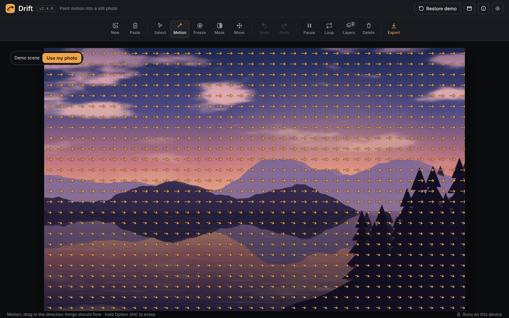

# Drift Studio
[Launch Drift Studio](https://github.com/dougalder/drift-studio/)
**Version 2.4.0**

Drift Studio paints motion into a still photo. You brush arrows over the parts of the picture that should move, such as clouds, water, or grass, and the app turns them into a seamless loop that repeats forever. You can freeze anything that must stay still, like a person or a building, and then export the loop as an MP4 video or an animated GIF.

It is a single web page. There is nothing to install and no account to create.

## Quick start

1. Download this project (see "Getting the files" below).
2. Double-click `index.html` to open the project page in your browser, then click **Open the app**. You can also open `drift-studio.html` directly.
3. Press **Paste** or **New** in the toolbar to bring in your own photo, or start with the built-in demo.
4. Paint with **Motion**, freeze with **Freeze**, and press **Export** when you are happy.

For a step-by-step walkthrough, read [MANUAL.md](MANUAL.md).

## What is in this project

| File or folder | What it is |
|---|---|
| `drift-studio.html` | The app itself. This single file holds all the code. |
| `index.html` | A simple project page with a button that opens the app. |
| `MANUAL.md` | The user manual, written in plain language, with screenshots. |
| `screenshots/` | Pictures of the app used in the manual. |
| `LICENSE` | The license for this project's own code (MIT). |
| `THIRD-PARTY-LICENSES.md` | The licenses and copyright notices for the open-source parts the app uses. |
| `.gitignore` | A list of file types that GitHub should not track (for example, exported videos). |

## Requirements

Drift Studio runs in a modern web browser. It needs three things:

- **WebGL 2** (a graphics feature that lets the browser use your computer's graphics chip to draw the preview quickly). Current versions of Chrome, Edge, and Firefox support it, and so do most recent versions of Safari. Some Safari setups block it. See the troubleshooting section of the manual.
- **An internet connection the first time you open the app**, so the typefaces can load from Google Fonts. Everything else works offline.
- **Enough memory** for large photos. Very large pictures use a lot of graphics memory.

It is designed to work in Safari on macOS, iPhone and iPad, and in Chrome, Edge, and Firefox on Windows and macOS. Not every device and browser combination has been tested, so please report problems.

## Privacy

Your photos are opened and processed by your own browser. Nothing is uploaded, there is no account, and the project has no server that receives your files. Closing or reloading the page clears your work, so export before you leave.

## Version history

| Version | Changes |
|---|---|
| 2.4.0 | Animated GIF export. Sizes from 320 to 1080 pixels, at 20 frames per second (smooth) or 10 (smaller). One shared colour palette so colours do not flicker. Loops forever. Uses gifenc 1.0.3 (MIT), included in the file. |
| 2.3.0 | Motion popover gains Paint and Erase modes (Option/Alt-drag also erases), a Layer speed slider, and "Remove all motion on this layer". The toolbar can sit at the top, left, or right, and the choice is remembered. Undo is more reliable. |
| 2.1.0 | Select pointer tool (A). Click an image to select its layer, drag to move it. ⌘X (Ctrl+X) or Delete/Backspace removes the selected layer, and Undo restores it. |
| 2.0.0 | Top toolbar replaces the side panel. Each tool or group opens a popover with its controls. Header with version number, Restore demo, toolbar position, How it works, and day/night mode. Layers list with drag-to-reorder. Transparent images are trimmed automatically. |

## Known limits

- Needs WebGL 2. Some Safari installations, including ones with Lockdown Mode or a browser-wide graphics block, cannot run the app until the setting is changed.
- MP4 export uses H.264 only up to about 3072 × 3072 pixels for square images. Larger sizes will not open in QuickTime.
- GIF frame timing is stored in hundredths of a second, so only 20 and 10 frames per second keep the loop exactly on time. GIF files grow quickly with size and loop length.
- Nothing is saved between visits. Export before closing.

## Ideas for later

- A Canvas 2D fallback renderer (a drawing method that does not need WebGL), so the app runs in Safari setups that block WebGL. It would be slower and use a lower preview resolution.

## Contributing and feedback

This is a single-file app with no build step. To change it, edit `drift-studio.html` in any text editor, then reload the page in your browser to see the change. When you make a release, update the version number in three places: the `<meta name="version">` tag, the `VERSION` constant in the script, and this README's version history.

## License

The code written for this project is released under the MIT License (see `LICENSE`). The open-source components it uses keep their own licenses, listed in `THIRD-PARTY-LICENSES.md`.

MIT is a permissive license. In plain terms, you may use, copy, change, and share the code, including in other projects, as long as you keep the copyright notice and license text with it. The software comes with no warranty.
